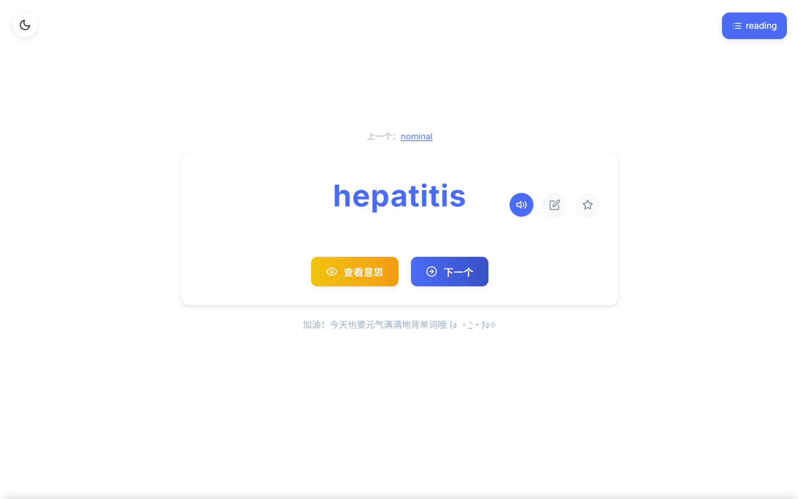
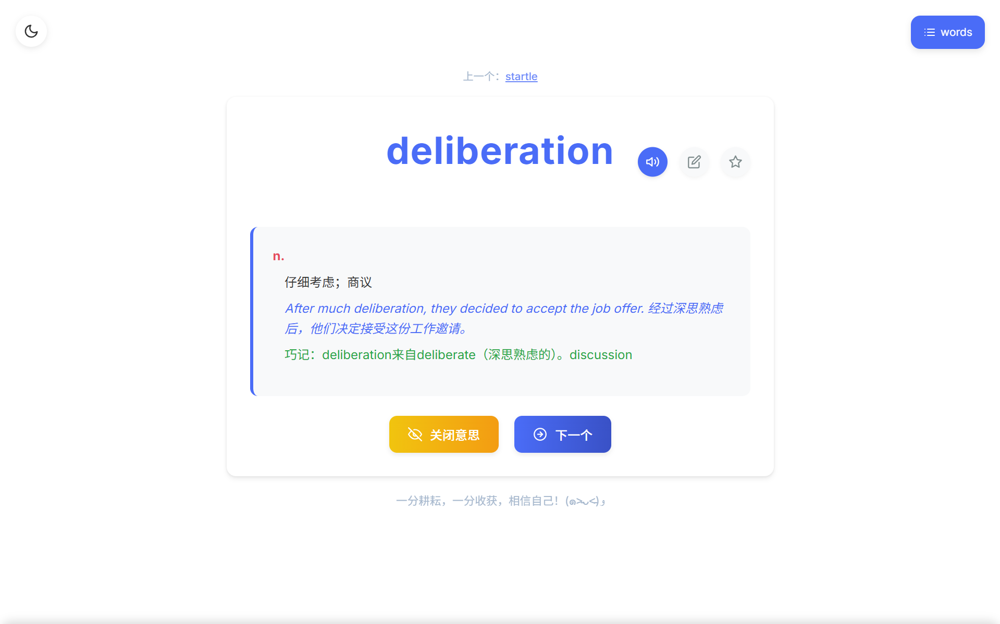
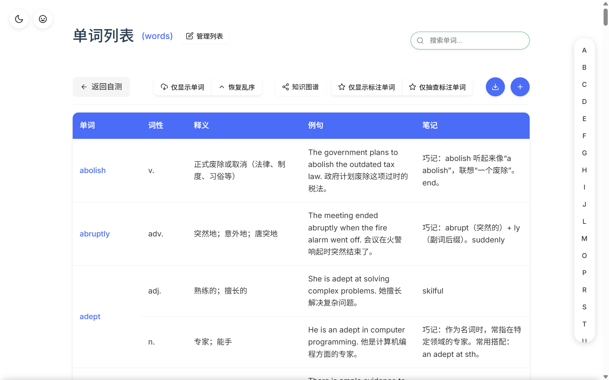
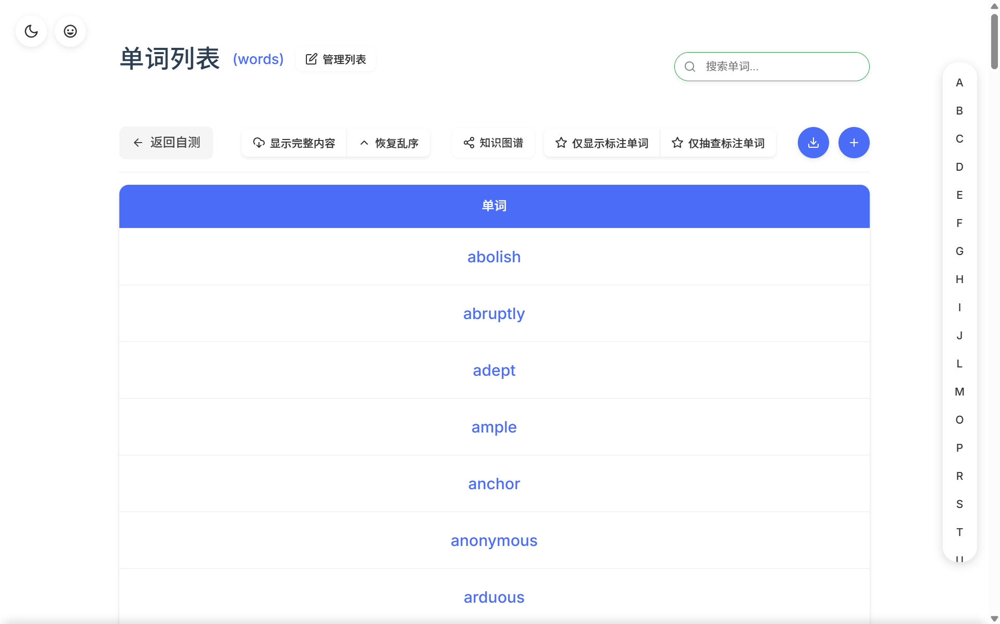
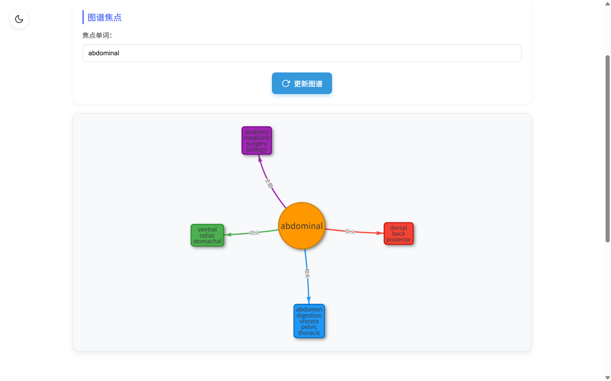
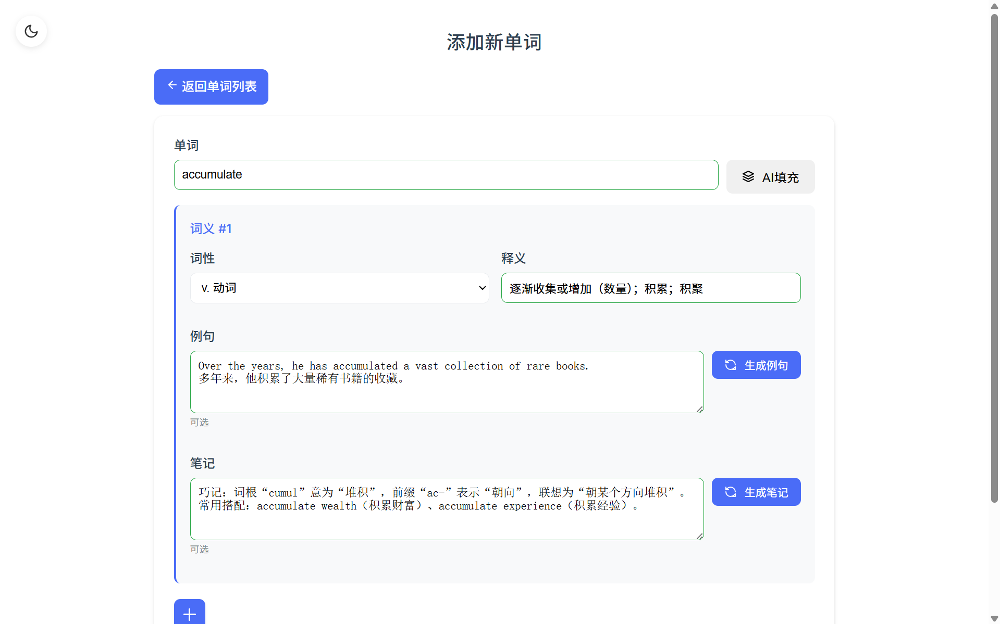

# WordNest

一个本地运行的英语单词学习系统：添加自己的生词，借助 AI 生成例句与记忆法，用知识图谱查看词与词之间的联系。

本仓库是 [wink-wink-wink555/WordNest](https://github.com/wink-wink-wink555/WordNest) 的二次开发版本。在保留原有全部功能的基础上，增加了容器化部署、移动端适配、每日学习记录、学习笔记与 AI 陪练等能力，并修复了若干影响使用的问题。

[功能说明](docs/FEATURES.md) · [部署手册](docs/DOCKER.md) · [架构说明](ARCHITECTURE.md) · [上游原文存档](docs/upstream/README.zh.md)

---

## 目录

- [功能特性](#功能特性)
- [界面预览](#界面预览)
- [快速开始](#快速开始)
- [配置项](#配置项)
- [导入自己的词表](#导入自己的词表)
- [项目结构](#项目结构)
- [文档](#文档)
- [数据与备份](#数据与备份)
- [与上游项目的关系](#与上游项目的关系)
- [许可证](#许可证)
- [English Summary](#english-summary)

---

## 功能特性

### 基础能力

| 能力 | 说明 |
| --- | --- |
| 单词抽查 | 只展示单词本身，点击查看词性、释义与例句 |
| 一词多义 | 同一个单词可维护多条词性与释义 |
| 个人词库 | 只收录自己添加的词；支持多个词表、星标、排序与筛选 |
| AI 生成 | 例句、记忆法、知识图谱均由大模型生成，可自定义服务地址 |
| 知识图谱 | 以图的形式展示单词之间的关联（Beta） |
| 夜间模式 | 适配不同光线环境 |

### 本版本新增

| 功能 | 说明 | 使用方式 |
| --- | --- | --- |
| 容器化部署 | 一条命令启动，数据落在宿主机，重建容器不丢 | `docker compose up -d --build` |
| 每日学习记录 | 按天汇总学过的词与复习次数，30 天柱状图，可按天复习 | 首页「学习记录」 |
| 学习笔记 | 多条笔记、可关联单词、可全文搜索，AI 会参考 | 首页「我的笔记」 |
| AI 四级助教 | 结合真实学习进度答疑、出题、给复习建议 | 页面左下角面板 |
| 按轮抽词 | 一轮内不重复，词库增删不错位，多端与重启接续 | 自动生效 |
| 本轮进度 | 显示当前轮次进度，便于判断还剩多少词 | 自测页底部 |
| 词表导入 | 从 CSV 批量导入，可并入现有词表或新建词表 | `python import_vocabulary.py` |
| 批量补全 | 为已有单词批量生成例句与记忆法 | `python enrich_words.py` |
| 访问密码 | 手机或公网访问时要求登录 | `.env` 中设置 `WORDNEST_PASSWORD` |
| 手机适配 | 窄屏下自动收起侧栏、重排操作区 | 手机浏览器直接访问 |

功能细节与使用说明见 [docs/FEATURES.md](docs/FEATURES.md)。

---

## 界面预览

| 单词抽查 | 查看释义 |
| --- | --- |
|  |  |

| 词表（显示释义） | 词表（隐藏释义） |
| --- | --- |
|  |  |

| 知识图谱 | 添加单词 |
| --- | --- |
|  |  |

---

## 快速开始

### 环境要求

| 必需 | 说明 |
| --- | --- |
| Docker Desktop（Windows / macOS）或 Docker Engine + Compose（Linux） | 唯一硬性依赖，Windows 建议启用 WSL2 后端 |
| 现代浏览器 | Chrome / Edge / Safari / Firefox 均可，手机浏览器也可访问 |

| 可选 | 用途 |
| --- | --- |
| Python 3.8+ | 运行 `import_vocabulary.py`、`enrich_words.py` 两个脚本（仅用标准库） |
| VSCode + Dev Containers | 在容器内开发与断点调试 |
| DeepSeek API Key | 使用 AI 相关功能 |

### 启动

```bash
docker compose up -d --build
```

浏览器打开 <http://localhost:5000>。未配置 API Key 时，除 AI 功能外其余功能均可正常使用。

### 配置 AI

```bash
cp .env.example .env      # Windows: copy .env.example .env
```

编辑 `.env`，填入密钥后重启容器：

```ini
DEEPSEEK_API_KEY=sk-你的密钥
```

```bash
docker compose up -d
```

---

## 配置项

均为可选，通过 `.env` 或环境变量传入：

| 变量 | 默认值 | 说明 |
| --- | --- | --- |
| `DEEPSEEK_API_KEY` | 空 | 大模型服务密钥，留空则 AI 功能不可用 |
| `DEEPSEEK_BASE_URL` | `https://api.deepseek.com` | 兼容 OpenAI 协议的服务地址 |
| `WORD_BANK_LIMIT` | `40` | 生成例句时从词表抽样的词数，`0` 表示关闭词库联动 |
| `WORDNEST_PORT` | `5000` | 宿主机端口 |
| `WORDNEST_PASSWORD` | 空 | 访问密码，留空表示不启用登录 |
| `WORDNEST_PROXY` | `http://host.docker.internal:7897` | 容器出网代理；不可用时自动回退直连 |
| `SECRET_KEY` | 内置占位值 | Flask 会话签名密钥，公网部署时应修改 |
| `TZ` | `Asia/Shanghai` | 容器时区，影响学习记录的日期归属 |
| `APT_MIRROR` / `PIP_INDEX_URL` | 阿里云 / 清华源 | 构建时软件源，海外环境可改为官方源 |

---

## 导入自己的词表

CSV 需带表头，最少包含「单词」和「释义」两列，例如：

```csv
序号,单词/短语,音标,词性,中文释义,类型,首字母
1,abuse,əˈbjuːs,n./v.,滥用；虐待；辱骂,单词,a
2,academy,əˈkædəmi,n.,学院；研究院；专科院校,单词,a
```

```bash
docker compose stop                                # 避免数据库写入竞争
python import_vocabulary.py --csv vocabulary.csv   # 导入到默认词表
docker compose start
```

- `--list cet4`：导入为独立词表，不影响现有数据
- `--replace`：覆盖已有词表（自动备份到 `backup/`）
- 仓库附带 `vocabulary.sample.csv`（20 个四级词）可用于试用

导入后可批量生成例句与记忆法：

```bash
python enrich_words.py --limit 10 --dry-run   # 预览
python enrich_words.py --limit 0              # 全部补齐
```

详细说明见 [docs/DOCKER.md](docs/DOCKER.md) 第四节。

---

## 项目结构

```
WordNest/
├── app.py                 应用入口与配置装配
├── config.py              路径、数据库与密钥配置
├── models.py              数据模型（词库 / 学习记录 / 笔记 / 抽词轮次）
├── chat_models.py         AI 对话模型
├── routes/                路由层：单词、词表、AI、学习记录、笔记、鉴权
├── services/              业务层：抽词、AI、学习统计、笔记、知识图谱
├── utils/                 工具：网络出口、鉴权、设置、常量、抽词轮次
├── templates/             Jinja2 页面模板
├── static/                前端脚本与样式
├── docs/                  部署手册、功能说明、上游原文存档
├── instance/              词库（运行时生成，每个词表一个 .db）
├── study_data/            学习记录与笔记（运行时生成）
├── chat_data/             AI 对话记录（运行时生成）
├── Dockerfile
├── docker-compose.yml
├── requirements.txt
├── import_vocabulary.py   CSV 词表导入
├── enrich_words.py        批量生成例句与记忆法
└── vocabulary.sample.csv  示例词表
```

---

## 文档

| 文档 | 内容 |
| --- | --- |
| [docs/FEATURES.md](docs/FEATURES.md) | 新增功能、优化项与使用方法 |
| [docs/DOCKER.md](docs/DOCKER.md) | 部署、配置、导入、备份、常见问题 |
| [ARCHITECTURE.md](ARCHITECTURE.md) | 项目架构与模块说明 |
| [CONTRIBUTING.md](CONTRIBUTING.md) | 贡献指南 |
| [SECURITY.md](SECURITY.md) | 安全问题反馈方式 |
| [docs/upstream/README.zh.md](docs/upstream/README.zh.md) | 上游项目原始说明（中文，存档） |
| [docs/upstream/README.en.md](docs/upstream/README.en.md) | 上游项目原始说明（英文，存档） |

---

## 数据与备份

| 目录 | 内容 | 是否可删除 |
| --- | --- | --- |
| `instance/` | 词库 | 否 |
| `study_data/study.db` | 学习记录、笔记 | 否 |
| `study_data/cycle.db` | 抽词轮次状态 | 可（删除后重新开始一轮） |
| `chat_data/` | AI 对话记录 | 可 |
| `settings.json` | 界面偏好 | 可 |

备份以上三个目录即可完成迁移；升级时替换代码后执行 `docker compose up -d --build`，数据目录不受影响。

---

## 项目缘起

我在准备大学英语四级，需要一个能装下自己生词、又能按自己的进度陪练的工具。原项目 WordNest 的功能方向正合适，但需要手动配置 Python 环境、只能在电脑上打开，也没有学习记录和笔记，于是我在它的基础上做了这个版本：

- 用 Docker 打包，换一台电脑或手机都能一条命令跑起来
- 增加学习记录与笔记，让背过的词有迹可循、可回看
- 增加 AI 陪练面板，围绕四级题型给出练习与讲解
- 重写抽词逻辑，避免短时间内反复出现同一个词

实现方式上，需求定义、交互与数据流程设计、测试验收和文档编写由我完成；代码实现大量借助 AI 辅助，我也借此系统学习了 Flask、容器化与数据库相关的实践。

---

## 与上游项目的关系

- 上游仓库：[wink-wink-wink555/WordNest](https://github.com/wink-wink-wink555/WordNest)，MIT 协议，版权归原作者所有
- 本仓库在其基础上做功能增强与问题修复，未改变原有数据字段与页面结构，上游数据可直接迁移
- 上游说明文档完整存档于 [docs/upstream/](docs/upstream/)，未作修改
- 新增功能、优化点与差异对照见 [docs/FEATURES.md](docs/FEATURES.md)
- 如原作者希望调整引用方式或下架本仓库，将立即处理

---

## 许可证

[MIT](LICENSE)。保留上游版权声明；二次开发部分同样以 MIT 发布。

---

## English Summary

WordNest is a self-hosted English vocabulary learning app built with Flask. You keep your own word lists, while AI generates example sentences, mnemonics and a knowledge graph of related words.

This fork of [WordNest](https://github.com/wink-wink-wink555/WordNest) (MIT) adds:

- One-command deployment with Docker Compose, no Python setup required
- Daily study log with per-day review and a 30-day chart
- Multi-note workspace that the AI assistant can reference
- AI assistant panel for exam-oriented practice (translation, grammar, confusing words)
- Round-based word drawing: no repeats within a round, resilient to list edits
- Optional password protection and a mobile-friendly layout

See [docs/DOCKER.md](docs/DOCKER.md) for setup and [docs/FEATURES.md](docs/FEATURES.md) for the feature list. The original project README is archived under [docs/upstream/](docs/upstream/).
